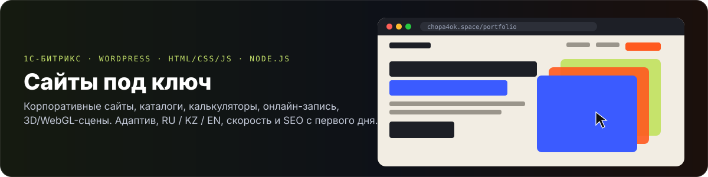

  
  
  
  

## 👋 Обо мне

Fullstack веб-разработчик из Казахстана. Делаю сайты и веб-системы **от идеи до «работает»**: структура, интерфейс, бэкенд, запуск и сопровождение.

- 🛠️ Сейчас в одиночку веду **15 коммерческих сайтов** на 1С-Битрикс и WordPress: доработки, новые функции, безопасность, отчёты.
- 🔍 Сильная сторона — **техническое SEO**: аудит, индексация, скорость, Search Console и Вебмастер. Под это написал собственный краулер.
- ⚙️ Люблю автоматизацию и довожу свои продукты до релиза: автообновления, тесты, свой сервер.
- 🗣️ Русский — родной, казахский — C2, английский — B2.

## 🚀 Свои продукты

<table>
  <tr>
    <td width="50%">
      
    </td>
    <td width="50%">
      
    </td>
  </tr>
  <tr>
    <td valign="top">
      <b>ChopaSEO</b>: настольное приложение для технического аудита сайта. 
      Многопоточный краулер на Go проверяет коды ответов, редиректы, robots.txt и sitemap.xml, дубли метатегов и PageSpeed. 
      Делает короткий отчёт в DOCX и полную таблицу в XLSX. Есть лицензии и встроенное автообновление.
    </td>
    <td valign="top">
      <b>ChopaVPN</b>: VPN-сервис полного цикла. 
      Backend: Go REST API + PostgreSQL. Клиент для Windows: Wails + React/TS. Клиент для Android: Java + Xray. 
      Подпись обновлений Ed25519, kill switch, выкладка с автооткатом, около 530 автотестов.
    </td>
  </tr>
</table>

> 💼 Исходный код коммерческих проектов закрыт: соглашения о неразглашении и код клиентов.
> Работы можно посмотреть в [портфолио](https://chopa4ok.space/portfolio/). Подробности расскажу на собеседовании.

## 🧰 Стек

   
  

  
  
  
  
  
  
  
  
  
  

## 📫 Связаться

  
  
  
  

